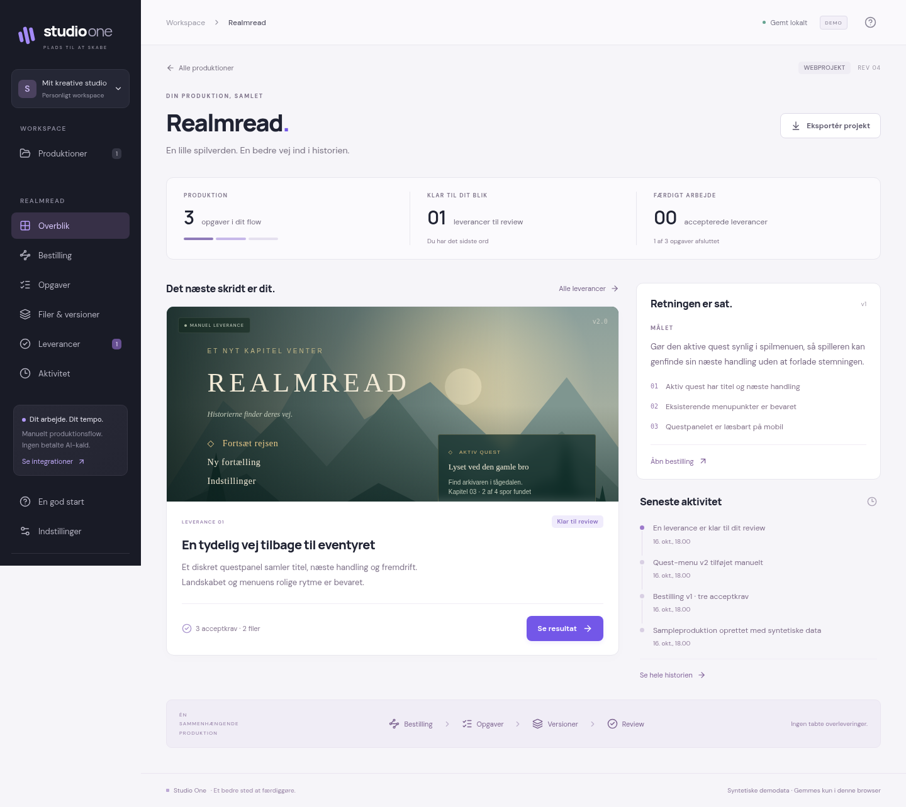
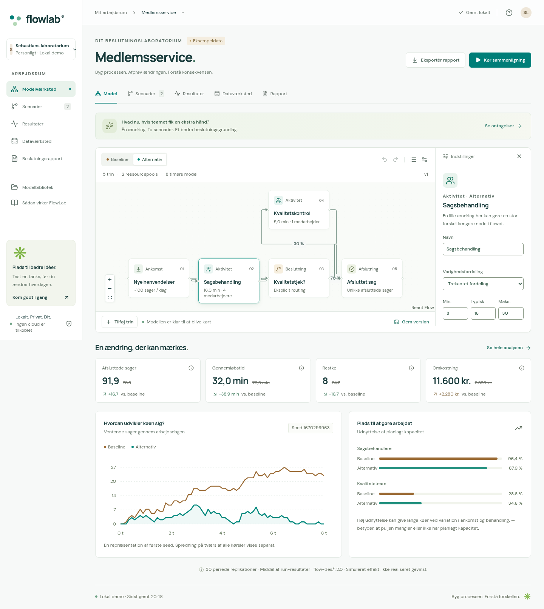
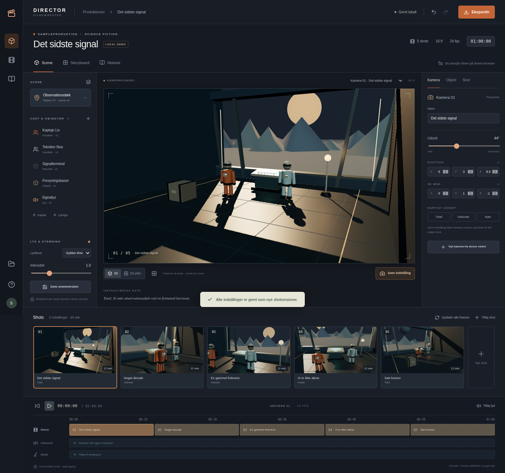

# Tre apps. Tre måder at få godt arbejde færdigt.

**Studio One**, **FlowLab** og **Director** er tre selvstændige Next.js-apps bygget efter den vedlagte Masterbibel. Denne udgave kan bruges lokalt uden API-nøgler. Den indeholder rigtige editorer, versionshistorik, beregninger og eksporter — med tydeligt mærkede, syntetiske eksempelprojekter.

Udviklingen er i gang. Se [aktuel status](STATUS.md), [verifikationsbeviser](reports/) og [beslutninger](DECISIONS.md). Cloud-login, kundedata, betalt AI-generation og betaling er ikke aktiveret.

## Start på din maskine

Krav: Node.js 24.19.0 og pnpm 11.25.0. Installér pnpm med `npm install -g pnpm@11.25.0`, hvis det mangler.

```bash
git clone https://github.com/sebastianlistfeirup/3appsI1.git
cd 3appsI1
pnpm install --frozen-lockfile
pnpm dev
```

| App        | Åbn                   | Første forløb                                                                                 |
| ---------- | --------------------- | --------------------------------------------------------------------------------------------- |
| Studio One | http://localhost:3000 | Åbn Realmread, sammenlign leverancen og giv et review. Opret derefter din egen bestilling.    |
| FlowLab    | http://localhost:3001 | Se medlemsservice-modellen, ændr kapacitet og kør 30 parrede sammenligninger. Hent rapporten. |
| Director   | http://127.0.0.1:3002 | Se scenen, justér kameraet, gem en ny shotversion og hent storyboard eller projektpakke.      |

Data gemmes i browserens IndexedDB. Hent en ZIP/JSON-kopi af arbejde, du vil beholde. To samtidige faner får en synlig versionskonflikt; den ene overskriver ikke stiltiende den anden. Ingen browserdata uploades automatisk til en server.

### Faktisk MP4 fra Director

Installér `ffmpeg` og `ffprobe` på din PATH. Start Director med den lokale renderprofil:

```bash
DIRECTOR_LOCAL_RENDER=1 pnpm dev:director
```

På PowerShell: `$env:DIRECTOR_LOCAL_RENDER="1"; pnpm dev:director`.

Tryk **Eksportér → MP4**. Den lokale worker samler ægte 1280×720, 24 fps H.264/AAC med kameraframes, egne klip og lyd. Appen binder til loopback; denne profil er til din egen maskine. Se [renderopsætning og grænser](docs/director-local-render.md). Eksempelfil: [60 sekunders MP4](reports/director/det-sidste-signal-720p.mp4).

## Se produkterne

### Studio One



Bestilling, opgaver med afhængigheder, immutable filversioner, manuelle leveringer, før/efter-preview, review og ZIP med SHA-256-manifest. Uploadet HTML vises isoleret, uden scripts eller eksterne netværkskald. Et manuelt resultat bliver aldrig kaldt en verificeret ekstern build.

### FlowLab



En deterministisk diskret hændelsesmotor, proceseditor, ressourcepuljer, kalender, routing, CSV-kvalitet og baseline/scenarier med samme seeds. Resultater viser spredning og begrænsninger; PDF og JSON bruger samme beregninger. Et syntetisk udfald er en simulering, ikke dokumenteret forretningsgevinst.

### Director



3D-scene og brugbar 2D-fallback, egne GLB-modeller, fem kameraer, immutable shotversioner, framebaseret tidslinje, egne medier og rigtige eksporter. MP4'en er en animatic med stillbilleder og klip; der loves ikke kontinuerlig karakteranimation.

## Kontroller arbejdet

```bash
pnpm typecheck
pnpm test
pnpm test:db
pnpm build
pnpm exec playwright install --with-deps chromium firefox webkit
pnpm test:browser
```

Browserpakken kræver også `ffmpeg`, `ffprobe` og `pdftotext` fra Poppler. Firefox-lydtesten kræver en lydtjeneste; brug den dokumenterede [lokale PulseAudio-testopsætning](docs/director-verification.md#render-and-recovery-gate) på en Linux-server uden lydkort. Luk lokale appservere før `pnpm test:browser`, som starter sine egne produktionsbuilds på port 3000–3002. GitHub Actions kører de samme gates og gemmer rapporter. Ét fejlet check stopper kørslen; tests, der ikke er udført, mærkes ikke som bestået.

`test:db` opretter en isoleret lokal PostgreSQL 17.10-instans, kører de rigtige migrationer og tester RLS, budgetter, pg-boss, revisioner og leases. Den rører ikke en ekstern database. [Backendprofilen](docs/backend-profile.md) beskriver det verificerede fundament og de forbindelser, der stadig mangler.

## Find rundt

- `apps/studio`, `apps/flowlab`, `apps/director`: uafhængige apps og builds.
- `packages/flow-engine`, `packages/scene-format`: testbare domænekerner.
- `packages/persistence`: lokal lagring, konfliktbeskyttelse og regressionstests.
- `packages/database`, `packages/jobs`, `packages/auth`, `packages/backend`: serverfundament og verificerede kontrakter.
- `services/worker`: separat jobproces og lokal Director-CLI.
- `migrations`: additive PostgreSQL-migrationer.
- `docs/spec`: tekstudtræk fra den brugerleverede PDF; autoritativ kilde for opgaven.
- `checkpoints`, `program`, `reports`: fremdrift, arbejdsmandat og konkrete beviser.

Versioner og platform er registreret i [VERSION_MATRIX.md](VERSION_MATRIX.md). Der er ikke valgt en offentlig produktlicens; se fontlicenserne i hver apps `public/fonts`.
